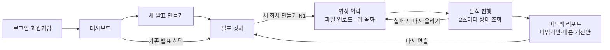

# Presento 프론트엔드 개발 가이드 (화면 기획 + API 명세)

> **AI 코딩 도구에게:** 이 문서는 Presento 웹 프론트엔드를 만들기 위한 유일한 기준 명세다.
> - API 경로, 필드명, 상태값, 에러 코드는 이 문서에 적힌 그대로 쓴다. 없는 필드나 엔드포인트를 지어내지 않는다.
> - 백엔드가 아직 없으므로 MSW(Mock Service Worker)로 4·5장의 예시 JSON을 그대로 응답하는 목업을 먼저 만든다.
> - 명세가 모호하거나 빠진 부분이 있으면 임의로 정하지 말고 `TODO(spec):` 주석을 남기고 사람에게 묻는다.
> - 권장 스택: React + TypeScript (Vite), React Router, axios, TanStack Query, MSW, Recharts.

---

## 1. 개요와 공통 규칙

**Presento**는 발표 영상을 업로드하거나 웹캠으로 녹화하면, AI가 말 속도·추임새·침묵·시선·자세·내용 구성을 분석해 타임라인 기반 피드백 리포트를 주는 웹 서비스다.

프론트는 이 문서의 화면 기획과 API 명세만 보고 백엔드 완성 전에 목업 데이터로 개발을 시작한다. 백엔드는 FastAPI로 만들고, 실제 서버가 뜨면 `/docs`(Swagger)에서 같은 명세를 직접 호출해볼 수 있다.

### 역할 분담

| 담당 | 범위 |
| --- | --- |
| 백엔드 | 인증, 업로드 URL 발급, 분석 파이프라인(whisper-1 + GPT + MediaPipe), 리포트 생성, DB·S3 |
| 프론트엔드 | 전체 화면, 업로드·웹 녹화, 분석 진행 표시, 리포트 시각화(영상 플레이어 + 타임라인) |

### 공통 규칙

| 항목 | 규칙 |
| --- | --- |
| Base URL | 로컬 `http://localhost:8000/api/v1`, 배포 후 도메인 공유 예정. 환경변수 `VITE_API_BASE_URL`로 관리 |
| 프론트 로컬 주소 | `http://localhost:5173` (백엔드 CORS 허용 목록에 등록) |
| 데이터 형식 | 요청·응답 모두 JSON, 필드명은 camelCase |
| 인증 | 로그인 응답의 `accessToken`을 `Authorization: Bearer <토큰>` 헤더에 담아 보냄 |
| 토큰 만료 | 24시간. 401을 받으면 로그인 화면으로 이동 |
| 시간 단위 | 영상 안의 위치는 모두 **초(소수점 2자리)**, 날짜는 ISO 8601(`2026-11-03T17:04:00+09:00`) |
| ID | 문자열 |
| 목록 | `?page=1&size=20`, 응답에 `items`, `page`, `size`, `total` |

### 에러 응답 형식

모든 에러는 HTTP 상태 코드와 함께 아래 모양으로 온다. 화면에는 `message`를 그대로 보여주면 된다.

```json
{
  "error": {
    "code": "FILE_TOO_LARGE",
    "message": "영상은 500MB 이하만 업로드할 수 있어요.",
    "details": null
  }
}
```

---

## 2. 화면 기획

화면은 7개이고, 시연의 핵심은 마지막 **피드백 리포트 화면**이다. 리포트에서 "다시 연습"을 누르면 같은 발표의 새 회차로 돌아간다.

### 화면 흐름



### 화면 목록

| 경로 | 화면 | 주요 요소 | 쓰는 API |
| --- | --- | --- | --- |
| `/login`, `/signup` | 로그인·회원가입 | 이메일·비밀번호 폼, 에러 문구 | A1, A2 |
| `/` | 대시보드 | 내 발표 카드 목록(제목, 목적, 최근 점수, 회차 수), "새 발표" 버튼 | A3, P2 |
| `/presentations/new` | 새 발표 만들기 | 제목, 발표 목적 선택(면접·수업·피칭·기타), 제한 시간, PDF 첨부(선택) | P1, P6 |
| `/presentations/:id` | 발표 상세 | 회차 목록, 성장 그래프(회차별 점수), "새 회차 연습" 버튼, 수정·삭제 | P3, P4, P5, P7 |
| `/presentations/:id/record` | 영상 입력 | 탭 2개: 파일 업로드(드래그 앤 드롭) / 웹 녹화(카메라 미리보기, 녹화 타이머, 제한 시간 표시), 업로드 진행률 | N1, S3 PUT, N2 |
| `/analyses/:id/progress` | 분석 진행 | 단계별 체크리스트, 진행 막대, 실패 시 에러 문구와 다시 올리기 버튼 | N3 |
| `/analyses/:id` | 피드백 리포트 | 왼쪽 영상 플레이어 + 타임라인 마커, 오른쪽 탭(요약·대본·피드백·개선 스크립트·예상 질문·슬라이드), "다시 연습" 버튼 | N4, N5 |

### 리포트 화면 핵심 동작

- 타임라인 마커나 피드백 카드를 클릭하면 영상이 그 구간 `start`로 이동해 재생된다.
- 재생 중에는 대본 탭에서 지금 말하는 문장이 하이라이트되고 자동 스크롤된다(`video`의 `timeupdate` 이벤트 사용).
- 추임새는 주황, 반복어는 보라 밑줄 등 단어 태그별로 색을 다르게 표시한다.
- 웹 녹화는 `MediaRecorder` API를 쓰고, 녹화가 끝나면 미리보기 후 "분석하기" 버튼으로 업로드한다.

---

## 3. API 목록

API는 16개이고, 영상 분석의 핵심 흐름은 **"업로드 URL 발급 → S3 직접 업로드 → 분석 시작 → 상태 조회 → 리포트 조회"** 5단계다. "발표"는 하나의 주제이고, 그 발표를 여러 번 연습한 각 회차가 "분석"이다.

| # | 분류 | Method | Path | 설명 | 인증 |
| --- | --- | --- | --- | --- | --- |
| A1 | 인증 | POST | `/auth/signup` | 회원가입 | X |
| A2 | 인증 | POST | `/auth/login` | 로그인, 토큰 발급 | X |
| A3 | 인증 | GET | `/users/me` | 내 정보 조회 | O |
| P1 | 발표 | POST | `/presentations` | 발표 만들기 | O |
| P2 | 발표 | GET | `/presentations` | 내 발표 목록 | O |
| P3 | 발표 | GET | `/presentations/{presentationId}` | 발표 상세 + 회차 목록 | O |
| P4 | 발표 | PATCH | `/presentations/{presentationId}` | 발표 정보 수정 | O |
| P5 | 발표 | DELETE | `/presentations/{presentationId}` | 발표 삭제(회차 포함) | O |
| P6 | 발표 | POST | `/presentations/{presentationId}/slides/upload-url` | 발표 자료 PDF 업로드 URL 발급 | O |
| P7 | 발표 | GET | `/presentations/{presentationId}/history` | 회차별 점수 추이(성장 그래프) | O |
| N1 | 분석 | POST | `/presentations/{presentationId}/analyses` | 새 회차 생성 + 영상 업로드 URL 발급 | O |
| N2 | 분석 | POST | `/analyses/{analysisId}/start` | 업로드 완료 알림, 분석 시작 | O |
| N3 | 분석 | GET | `/analyses/{analysisId}` | 분석 상태·진행률 조회(폴링) | O |
| N4 | 분석 | GET | `/analyses/{analysisId}/report` | 피드백 리포트 조회 | O |
| N5 | 분석 | GET | `/analyses/{analysisId}/video-url` | 영상 재생용 URL 발급 | O |
| N6 | 분석 | DELETE | `/analyses/{analysisId}` | 회차 삭제 | O |

분석 진행 상태는 **N3을 2초마다 폴링**하는 방식으로 구현한다. 실시간 이벤트(SSE)는 기본 기능이 끝난 뒤 여유가 있으면 추가한다.

---

## 4. API 상세 명세

아래 예시 JSON은 실제 응답과 같은 모양이라, 프론트 목업 데이터로 그대로 써도 된다.

### A1. 회원가입 `POST /auth/signup`

요청

```json
{ "email": "student@ycu.ac.kr", "password": "presento1234", "nickname": "영훈" }
```

응답 `201 Created` — 가입과 동시에 로그인 상태가 된다.

```json
{
  "accessToken": "eyJhbGciOiJIUzI1NiIs...",
  "user": { "id": "u-1a2b", "email": "student@ycu.ac.kr", "nickname": "영훈", "createdAt": "2026-11-03T17:04:00+09:00" }
}
```

- 비밀번호 8자 이상. 이메일 중복이면 `409 EMAIL_ALREADY_EXISTS`.

### A2. 로그인 `POST /auth/login`

요청 `{ "email": "...", "password": "..." }` → 응답 `200` 은 A1과 같은 모양. 틀리면 `401 INVALID_CREDENTIALS`.

### A3. 내 정보 `GET /users/me`

응답 `200` — A1 응답의 `user` 객체.

### P1. 발표 만들기 `POST /presentations`

요청

```json
{ "title": "캡스톤 중간 발표", "purpose": "CLASS", "timeLimitSec": 300 }
```

- `purpose`: `INTERVIEW`(면접), `CLASS`(수업 발표), `PITCH`(피칭·대회), `ETC`. 평가 기준(루브릭)이 이 값에 따라 바뀐다.
- `timeLimitSec`: 선택. 없으면 시간 초과 평가를 하지 않는다.

응답 `201`

```json
{
  "id": "p-7f3c",
  "title": "캡스톤 중간 발표",
  "purpose": "CLASS",
  "timeLimitSec": 300,
  "hasSlides": false,
  "attemptCount": 0,
  "latestScore": null,
  "createdAt": "2026-11-03T17:10:00+09:00"
}
```

### P2. 내 발표 목록 `GET /presentations?page=1&size=20`

응답 `200` — 최근 수정순.

```json
{ "items": [ { "id": "p-7f3c", "title": "캡스톤 중간 발표", "purpose": "CLASS", "timeLimitSec": 300, "hasSlides": true, "attemptCount": 3, "latestScore": 82, "createdAt": "2026-11-03T17:10:00+09:00" } ], "page": 1, "size": 20, "total": 1 }
```

### P3. 발표 상세 `GET /presentations/{presentationId}`

응답 `200` — P1 응답에 회차 목록 `attempts`가 붙는다(최신 회차가 앞).

```json
{
  "id": "p-7f3c", "title": "캡스톤 중간 발표", "purpose": "CLASS", "timeLimitSec": 300, "hasSlides": true,
  "attempts": [
    { "analysisId": "a-9d21", "attemptNo": 3, "status": "COMPLETED", "overallScore": 82, "durationSec": 287.4, "createdAt": "2026-11-05T20:00:00+09:00" },
    { "analysisId": "a-55e0", "attemptNo": 2, "status": "FAILED", "overallScore": null, "durationSec": null, "createdAt": "2026-11-04T21:30:00+09:00" }
  ]
}
```

### P4. 발표 수정 `PATCH /presentations/{presentationId}`

요청: 바꿀 필드만 보냄 `{ "title": "캡스톤 최종 발표" }` → 응답 `200` P1 모양.

### P5. 발표 삭제 `DELETE /presentations/{presentationId}`

응답 `204 No Content`. 회차·영상도 함께 삭제된다.

### P6. 발표 자료 PDF 업로드 `POST /presentations/{presentationId}/slides/upload-url`

요청 `{ "fileName": "slides.pdf", "contentType": "application/pdf", "fileSize": 3145728 }` (20MB 이하)

응답 `200` — 업로드 방법은 N1과 같다(받은 URL로 PUT). 업로드가 끝나면 다음 분석부터 슬라이드 일치도가 계산된다.

```json
{ "uploadUrl": "https://presento-bucket.s3.amazonaws.com/...", "method": "PUT", "headers": { "Content-Type": "application/pdf" }, "expiresInSec": 600 }
```

### P7. 성장 기록 `GET /presentations/{presentationId}/history`

응답 `200` — 완료된 회차만, 오래된 순. 성장 그래프에 그대로 쓴다.

```json
{
  "items": [
    { "attemptNo": 1, "analysisId": "a-1c4f", "createdAt": "2026-11-03T21:00:00+09:00", "overallScore": 64, "scores": { "DELIVERY": 58, "NONVERBAL": 70, "CONTENT": 65 }, "fillerCount": 31, "syllablesPerMin": 392 },
    { "attemptNo": 3, "analysisId": "a-9d21", "createdAt": "2026-11-05T20:00:00+09:00", "overallScore": 82, "scores": { "DELIVERY": 80, "NONVERBAL": 84, "CONTENT": 81 }, "fillerCount": 9, "syllablesPerMin": 341 }
  ]
}
```

### N1. 새 회차 + 영상 업로드 URL `POST /presentations/{presentationId}/analyses`

요청

```json
{ "fileName": "take3.webm", "contentType": "video/webm", "fileSize": 84213760, "source": "RECORDING" }
```

- `contentType`: `video/mp4`, `video/quicktime`(mov), `video/webm` 중 하나. 웹 녹화는 크롬이 webm, 사파리가 mp4로 나온다.
- `fileSize`: 바이트. 500MB 이하. `source`: `UPLOAD` 또는 `RECORDING`.

응답 `201`

```json
{
  "analysisId": "a-9d21",
  "attemptNo": 3,
  "status": "WAITING_UPLOAD",
  "upload": {
    "uploadUrl": "https://presento-bucket.s3.amazonaws.com/videos/a-9d21?X-Amz-Signature=...",
    "method": "PUT",
    "headers": { "Content-Type": "video/webm" },
    "expiresInSec": 900
  }
}
```

**업로드 방법(프론트):** 파일을 우리 서버가 아니라 `uploadUrl`로 **직접 PUT** 한다. `headers`를 반드시 그대로 넣어야 한다(다르면 S3가 403을 준다). `Authorization` 헤더는 넣지 않는다(axios 인스턴스의 인터셉터가 붙이지 않도록 별도 호출). 진행률 표시는 `axios`의 `onUploadProgress`를 쓰면 된다.

```ts
await axios.put(upload.uploadUrl, file, {
  headers: upload.headers,
  onUploadProgress: (e) => setPercent(Math.round((e.loaded / (e.total ?? 1)) * 100)),
});
```

### N2. 분석 시작 `POST /analyses/{analysisId}/start`

업로드가 끝난 직후 호출. 요청 본문 없음.

응답 `202 Accepted` `{ "analysisId": "a-9d21", "status": "QUEUED" }`

- 서버가 S3에 파일이 없으면 `409 UPLOAD_NOT_FOUND`, 10분을 넘는 영상이면 `422 VIDEO_TOO_LONG`.

### N3. 분석 상태 `GET /analyses/{analysisId}`

분석 진행 화면에서 2초마다 호출하고, `status`가 `COMPLETED` 또는 `FAILED`가 되면 멈춘다.

```json
{
  "analysisId": "a-9d21",
  "presentationId": "p-7f3c",
  "attemptNo": 3,
  "status": "PROCESSING",
  "stage": "TRANSCRIBING",
  "progress": 35,
  "error": null,
  "createdAt": "2026-11-05T20:00:00+09:00",
  "completedAt": null
}
```

실패하면 `"status": "FAILED"`, `"error": { "code": "NO_SPEECH_DETECTED", "message": "영상에서 목소리를 찾지 못했어요." }`.

### N4. 리포트 `GET /analyses/{analysisId}/report`

응답 `200` — 구조는 5장 참고. 아직 분석 중이면 `409 ANALYSIS_NOT_READY`.

### N5. 영상 재생 URL `GET /analyses/{analysisId}/video-url`

응답 `200` `{ "videoUrl": "https://presento-bucket.s3.amazonaws.com/...", "expiresInSec": 3600 }` — `<video src>`에 넣는다. 1시간 뒤 만료되므로 리포트 화면에 들어올 때마다 새로 받는다.

### N6. 회차 삭제 `DELETE /analyses/{analysisId}`

응답 `204 No Content`.

---

## 5. 리포트 데이터 구조 (N4 응답)

리포트 하나로 리포트 화면 전체를 그린다. 영상 위 타임라인 마커는 `feedbacks`의 `start`·`end`(초)로 찍는다.

```json
{
  "analysisId": "a-9d21",
  "presentationId": "p-7f3c",
  "attemptNo": 3,
  "purpose": "CLASS",
  "durationSec": 287.4,
  "createdAt": "2026-11-05T20:00:00+09:00",

  "overall": {
    "score": 82,
    "grade": "B+",
    "summary": "핵심 메시지가 분명하고 시선 처리가 안정적이에요. 도입부 말 속도와 '약간' 같은 추임새만 줄이면 좋아요.",
    "strengths": ["결론에서 핵심을 다시 정리함", "정면 시선 비율이 높음"],
    "improvements": ["도입 30초의 말 속도가 빠름", "'약간', '이제' 반복"]
  },

  "scores": [
    { "category": "DELIVERY",  "label": "전달력",   "score": 80 },
    { "category": "NONVERBAL", "label": "비언어",   "score": 84 },
    { "category": "CONTENT",   "label": "내용 구성", "score": 81 }
  ],

  "metrics": {
    "speech": {
      "syllablesPerMin": 341,
      "paceSeries": [ { "t": 0, "value": 402 }, { "t": 30, "value": 355 }, { "t": 60, "value": 330 } ],
      "fillerCount": 9,
      "fillers": [ { "word": "약간", "count": 4 }, { "word": "이제", "count": 3 }, { "word": "음", "count": 2 } ],
      "silenceCount": 3,
      "longestSilenceSec": 3.8,
      "timeLimitSec": 300,
      "overTimeSec": 0
    },
    "nonverbal": {
      "gazeFrontRatio": 0.78,
      "postureStability": 0.86,
      "gesturePerMin": 6.2,
      "lowConfidenceRanges": [ { "start": 120.0, "end": 128.5 } ]
    }
  },

  "feedbacks": [
    {
      "id": "f-01",
      "category": "DELIVERY",
      "type": "PACE_FAST",
      "severity": "WARNING",
      "start": 0.0,
      "end": 31.2,
      "title": "도입부 말이 빨라요",
      "description": "첫 30초가 분당 402음절로 평균보다 18% 빨라요. 청중이 주제를 잡기 전에 넘어가요.",
      "evidence": "오늘 저희가 발표할 주제는 AI 기반 발표 피드백 서비스인데요",
      "suggestion": "첫 문장 뒤에 1초 쉬고, 주제 문장을 한 번 더 천천히 말해 보세요."
    },
    {
      "id": "f-02",
      "category": "NONVERBAL",
      "type": "GAZE_AWAY",
      "severity": "INFO",
      "start": 152.0,
      "end": 163.5,
      "title": "시선이 화면 밖으로 벗어나요",
      "description": "약 11초 동안 정면을 보지 않았어요. 슬라이드를 읽는 구간으로 보여요.",
      "evidence": null,
      "suggestion": "슬라이드는 핵심 단어만 확인하고, 문장을 말할 때는 카메라를 보세요."
    }
  ],

  "transcript": {
    "segments": [
      {
        "id": "s-001",
        "start": 0.0,
        "end": 6.4,
        "text": "안녕하세요 음 오늘 저희가 발표할 주제는",
        "words": [
          { "text": "안녕하세요", "start": 0.0, "end": 0.9, "tag": null },
          { "text": "음", "start": 1.1, "end": 1.4, "tag": "FILLER" }
        ]
      }
    ]
  },

  "improvedScripts": [
    {
      "segmentId": "s-014",
      "start": 95.2,
      "end": 108.0,
      "original": "그래서 이제 약간 이 기능이 있으면 사용자가 약간 편하게 쓸 수 있을 것 같아서",
      "improved": "이 기능으로 사용자는 연습할 때마다 고칠 점을 바로 확인할 수 있습니다.",
      "reason": "추임새를 빼고, '것 같다'를 단정형으로 바꿔 자신감 있게 들리게 했어요."
    }
  ],

  "expectedQuestions": [
    { "question": "기존 발표 연습 앱과 무엇이 다른가요?", "intent": "차별점 확인", "answerTip": "타임스탬프 근거 피드백을 예시 화면과 함께 설명하세요." }
  ],

  "slideCoverage": [
    { "page": 1, "covered": true,  "note": null },
    { "page": 4, "covered": false, "note": "'경쟁 서비스 비교' 슬라이드를 설명하지 않았어요." }
  ]
}
```

### 필드별 화면 매핑

| 필드 | 화면에서 쓰는 곳 | 비고 |
| --- | --- | --- |
| `overall` | 리포트 상단 요약 카드 | `score` 0~100 정수 |
| `scores` | 항목별 점수 막대 또는 레이더 차트 | 항목은 항상 3개 |
| `metrics.speech.paceSeries` | 말 속도 꺾은선 차트 | `t`는 구간 시작 초, 30초 간격 |
| `metrics.speech.fillers` | 추임새 순위 목록 | 많은 순으로 정렬되어 옴 |
| `metrics.nonverbal` | 비언어 지표 카드 | 비율은 0~1, 화면에서 %로 변환. `gazeFrontRatio`·`postureStability`·`gesturePerMin`은 측정 불가 시 null, 화면에는 '측정 불가'로 표시 |
| `nonverbal.lowConfidenceRanges` | 타임라인에 회색 구간 | 얼굴과 몸이 모두 잡히지 않아 평가에서 뺀 구간 |
| `feedbacks` | 타임라인 마커 + 피드백 목록 | 마커 클릭 시 `video.currentTime = start` |
| `feedbacks.severity` | 마커 색 | `INFO` 파랑, `WARNING` 주황, `CRITICAL` 빨강 |
| `feedbacks.evidence` | 피드백 카드의 근거 인용 | 실제 대본에서 가져온 문장. **evidence: 시선·자세 피드백은 null일 수 있음** (인용할 대본이 없을 때). null이면 인용 영역을 숨긴다 |
| `transcript.segments` | 대본 탭 | 재생 중인 문장 하이라이트, 문장 클릭 시 그 초로 이동 |
| `words.tag` | 대본 안 단어 색 | `FILLER` 추임새, `REPEAT` 반복어, `null` 일반 |
| `improvedScripts` | 개선 스크립트 탭 | 원문/개선문 나란히 보기 |
| `expectedQuestions` | 예상 질문 탭 | 5개 내외 |
| `slideCoverage` | 슬라이드 일치도 탭 | PDF를 올린 경우에만 오고, 없으면 `null` |

**`feedbacks.type` 값 목록:** `PACE_FAST`, `PACE_SLOW`, `FILLER`, `LONG_SILENCE`, `OVER_TIME`, `UNDER_TIME`, `GAZE_AWAY`, `POSTURE_UNSTABLE`, `GESTURE_NONE`, `GESTURE_EXCESS`, `STRUCTURE`, `CLARITY`, `SLIDE_MISSED`. 아이콘을 type별로 정하면 된다.

**`feedbacks.category` 값:** `DELIVERY`, `NONVERBAL`, `CONTENT` (`scores.category`와 같은 값).

---

## 6. 분석 상태, 에러 코드, 개발 순서

분석은 `WAITING_UPLOAD → QUEUED → PROCESSING → COMPLETED` 순서로 진행되고, 어느 단계에서든 `FAILED`로 끝날 수 있다.

### 분석 상태 `status`

| status | 의미 | 프론트 처리 |
| --- | --- | --- |
| `WAITING_UPLOAD` | 회차만 생성, 영상 업로드 전 | 업로드 진행률 표시 후 N2 호출 |
| `QUEUED` | 분석 대기열에 들어감 | "분석 준비 중" 표시, 폴링 시작 |
| `PROCESSING` | 분석 중, `stage`와 `progress` 갱신 | 단계 표시 + 진행 막대 |
| `COMPLETED` | 리포트 준비 완료 | 폴링 멈추고 리포트 화면으로 이동 |
| `FAILED` | 분석 실패, `error` 채워짐 | `error.message` 표시 + "다시 올리기" 버튼 |

### 분석 단계 `stage` (PROCESSING일 때)

| stage | 화면 문구 | 대략 progress |
| --- | --- | --- |
| `EXTRACTING_AUDIO` | 영상에서 음성을 꺼내는 중 | 0~10 |
| `TRANSCRIBING` | 말을 받아쓰는 중 | 10~40 |
| `ANALYZING_NONVERBAL` | 시선과 자세를 보는 중 | 40~65 |
| `ANALYZING_CONTENT` | 발표 내용을 살펴보는 중 | 65~80 |
| `GENERATING_FEEDBACK` | 피드백을 정리하는 중 | 80~100 |

### 에러 코드

| HTTP | code | 상황 |
| --- | --- | --- |
| 400 | `VALIDATION_ERROR` | 필수값 누락, 형식 오류(`details`에 필드별 이유) |
| 401 | `UNAUTHORIZED` | 토큰 없음·만료 → 로그인 화면으로 |
| 401 | `INVALID_CREDENTIALS` | 이메일 또는 비밀번호 틀림 |
| 403 | `FORBIDDEN` | 다른 사람의 발표·회차 접근 |
| 404 | `NOT_FOUND` | 없는 발표·회차 |
| 405 | `METHOD_NOT_ALLOWED` | 경로는 있지만 지원하지 않는 HTTP 메서드로 호출 |
| 409 | `EMAIL_ALREADY_EXISTS` | 이미 가입된 이메일 |
| 409 | `UPLOAD_NOT_FOUND` | 업로드 전에 분석 시작 호출 |
| 409 | `ANALYSIS_NOT_READY` | 분석 완료 전 리포트 요청 |
| 413 | `FILE_TOO_LARGE` | 영상 500MB, PDF 20MB 초과 |
| 415 | `UNSUPPORTED_FILE_TYPE` | mp4·mov·webm·pdf 외 형식 |
| 422 | `VIDEO_TOO_LONG` | 10분 초과 영상 |
| 429 | `RATE_LIMITED` | 하루 분석 횟수(사용자당 20회) 초과 |
| 500 | `INTERNAL_ERROR` | 서버 오류 |

분석 실패 이유(N3의 `error.code`): `NO_SPEECH_DETECTED`(목소리 없음), `NO_FACE_DETECTED`(얼굴이 거의 안 보임), `CORRUPTED_VIDEO`(재생 불가 파일), `AI_SERVICE_ERROR`(외부 AI 호출 실패, 다시 시도하면 됨).

### 프론트 개발 순서 (백엔드를 기다리지 않는 방법)

1. **목업 먼저:** MSW로 이 문서의 예시 JSON을 그대로 응답하게 만든다. 4·5장 예시를 복사해서 `src/mocks/` 폴더에 둔다. 분석 진행은 N3 목업이 호출될 때마다 `progress`가 올라가다 `COMPLETED`가 되게 만든다.
2. **타입 정의:** 5장 리포트 JSON으로 TypeScript 타입(`Report`, `Feedback`, `Segment` 등)을 먼저 만든다. 백엔드 Swagger가 나오면 `openapi-typescript`로 자동 생성한 타입과 비교한다.
3. **화면 순서:** 로그인 → 대시보드 → 발표 만들기 → 영상 입력(파일 업로드 먼저, 녹화는 나중) → 분석 진행 → 리포트.
4. **리포트 화면이 시연의 핵심**이니 가장 많은 시간을 쓴다. 영상 플레이어와 타임라인 마커, 대본 동기화가 우선이다.
5. **백엔드 연결:** 목업을 끄고 `VITE_API_BASE_URL`만 바꿔 실제 서버에 붙인다.

### 아직 정해지지 않은 것 (임의로 구현하지 말 것)

- [ ] 배포 도메인과 S3 버킷 CORS에 프론트 배포 주소 추가
- [ ] 하루 분석 횟수 제한(현재 20회) 확정
- [ ] 소셜 로그인(카카오 등) 넣을지 여부 — 지금 명세는 이메일 로그인만
